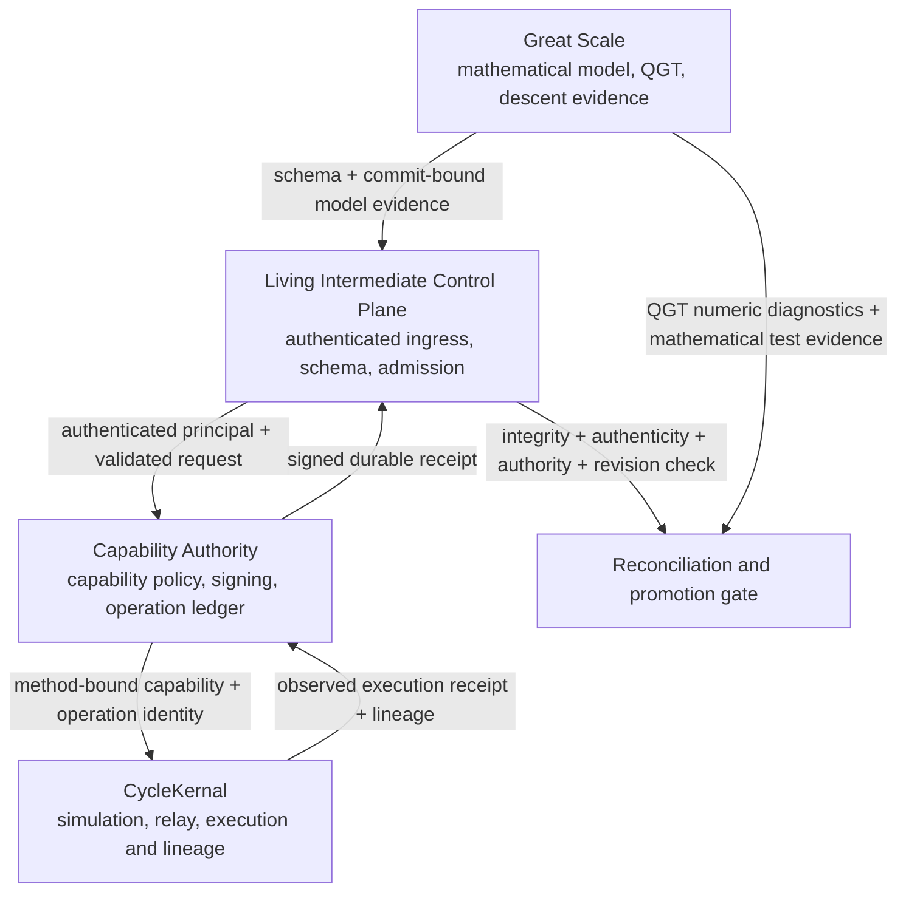

# Cross-Repository Verification and Promotion Plan

Status: proposed engineering contract; not evidence that dependent PRs have passed.
Audit date: 2026-10-26.

## Purpose

Coordinate promotion across Great Scale, Living Intermediate Control Plane (LICP), CycleKernal, and Capability Authority without treating a green advisory check, a syntactically valid evidence record, or a model-derived scalar as proof of end-to-end correctness.

## Trust and data flow



Arrows express required trust dependencies, not proof that every integration is currently implemented.

## Required acceptance predicate

A promotion consumer should independently validate all of the following:

`Accept(e) = Integrity(e) AND Authenticity(e) AND Execution(e) AND Authority(e) AND RevisionBinding(e)`

- **Integrity:** canonical serialization and digest/signature cover the complete accepted payload.
- **Authenticity:** issuer identity chains to an explicitly provisioned trust anchor. A hash alone does not authenticate an issuer.
- **Execution:** evidence is tied to an actual run/job and observed outcome, not merely an intended operation.
- **Authority:** the issuing principal had rights for the exact resource and method, under valid constraints and expiry.
- **Revision binding:** repository, full commit SHA, workflow run/job IDs, and produced artifact digest match the candidate being evaluated.

These checks are conjunctive. They must not be collapsed into a single ambiguous boolean without preserving reasons and provenance for each sub-result.

## Merge dependency order

1. **Baseline and CI observability.** Record each repository's default-branch SHA and PR base/head SHAs; restore workflow job-step and log access. A failed job with no steps is an infrastructure/verification blocker with an unknown cause, not proof that code assertions failed.
2. **Local security gates.**
   - LICP #23: bearer parsing, tokenless non-loopback bind refusal, sensitive route auth.
   - Capability Authority #5: exact `(type, resource, method)` matching; method-bound rate limit and receipt identity.
   - Capability Authority #7: explicit least-privilege issuance allowlist.
   - Capability Authority #8/#9: provisioned signing key and fail-closed startup validation.
3. **Execution/evidence durability.** Capability Authority #12 must provide durable event identity, concurrency-safe append, safe replay, corruption detection, and reconciliation. Stable event IDs do not alone guarantee exactly-once external side effects.
4. **Cross-repository admission.** LICP #15/#20 and Great Scale #124/#126/#128 should use one versioned envelope and exact revision identity. Structural validation is not a cryptographic trust gate.
5. **CycleKernal execution provenance.** CycleKernal #9 must pass its actual compile, simulation, relay parser, lineage, and container-build workflow. No syntax fix should be introduced unless an exact file/line failure is reproduced.
6. **Mathematical/numerical promotion.** Great Scale #116 and #122 need exact-head numerical and quotient regression results, including extreme-scale representability. Downstream evidence consumers must handle nullable raw determinants and their explicit statuses. For the evidence stack, evaluate #127 (side-effect/acknowledgement boundary) before #128 (projection/idempotency reconciliation).
7. **End-to-end promotion.** Run failure injection, replay, authorization mismatch, stale-revision, cross-language parity, and reconciliation scenarios against pinned candidate commits. Only then consider merge order and deployment.

## PR map (review pointers; status must be refreshed at promotion time)

| Repository | PR | Required gate |
|---|---:|---|
| Living Intermediate Control Plane | [#23](https://github.com/doitupsolutions810-crow/living-intermediate-control-plane/pull/23) | Bearer parsing plus route/network auth regressions and inspectable exact-head CI |
| Capability Authority | [#5](https://github.com/doitupsolutions810-crow/capability-authority/pull/5) | Method-bound authorization, receipt identity, rate-limit tuple |
| Capability Authority | [#7](https://github.com/doitupsolutions810-crow/capability-authority/pull/7) | Rights allowlist enforced at issuance |
| Capability Authority | [#8](https://github.com/doitupsolutions810-crow/capability-authority/pull/8) | Key provisioning, file safety, no silent production regeneration |
| Capability Authority | [#9](https://github.com/doitupsolutions810-crow/capability-authority/pull/9) | Startup/readiness integration for key and policy validation |
| Capability Authority | [#12](https://github.com/doitupsolutions810-crow/capability-authority/pull/12) | Durable ledger and fail-closed evidence index with replay/recovery tests |
| Living Intermediate Control Plane | [#15](https://github.com/doitupsolutions810-crow/living-intermediate-control-plane/pull/15) | Authenticated CycleKernal provenance |
| Living Intermediate Control Plane | [#20](https://github.com/doitupsolutions810-crow/living-intermediate-control-plane/pull/20) | Structural validator only; cryptographic verifier remains separate |
| CycleKernal | [#9](https://github.com/doitupsolutions810-crow/CycleKernal/pull/9) | Actual Python compile, test suite, relay tests, and both images |
| Great Scale | [#116](https://github.com/doitupsolutions810-crow/great-scale/pull/116) | Compensated QGT, eigenvalue conditioning, explicit raw determinant status |
| Great Scale | [#122](https://github.com/doitupsolutions810-crow/great-scale/pull/122) | Quotient fiber invariance distinguished from seam continuity |
| Great Scale | [#124](https://github.com/doitupsolutions810-crow/great-scale/pull/124), [#126](https://github.com/doitupsolutions810-crow/great-scale/pull/126) | Evidence classification and acceptance contract |\n| Great Scale | [#127](https://github.com/doitupsolutions810-crow/great-scale/pull/127) → [#128](https://github.com/doitupsolutions810-crow/great-scale/pull/128) | Side-effect / acknowledgement boundary precedes projection reconciliation; refresh the stack because #128's reported base SHA differed from #127's current head SHA during this review |

This table describes dependencies and verification requirements, not confirmed merge readiness. Observed stack facts on 2026-10-26: CycleKernal #9 targets `feature/great-scale-descent-wire`, whose head matches CycleKernal #1's reviewed head. Capability Authority #9 targets `fix/provisioned-signing-key-production`, whose head matches Capability Authority #8's reviewed head. Great Scale #128 names the PR #127 branch as its base, but its recorded base SHA (`101a9b9aa8ff7f71ba6d2ca123190847873a4f2f`) differs from PR #127's current reviewed head (`f93b5d7520ae9a483a30ed77d8fa952fd6003a71`). Reconcile that divergence before treating the stack as current. Branch ancestry and ahead/behind counts must be refreshed before promoting stacked PRs.

## Operation idempotency and recovery contract

An evidence event and an external side effect are different identities. For an action, require a stable operation ID and canonical request digest. A retry with the same ID and same digest must resolve to the original outcome or an explicit indeterminate state; a retry with the same ID and a different digest must be rejected.

If an external side effect may have committed but its acknowledgement is lost, the system must reconcile authoritative state before retrying. A unique event ID prevents duplicate evidence records; it does not make a non-idempotent side effect execute exactly once.

Prefer one transactional source of truth (for example, a SQLite ledger with projections derived from it), or a durable outbox with sequence/watermark and reconciliation. A process-local lock and atomic JSON rename do not prevent stale writers in other processes.

## QGT numerical contract

The QGT bridge accepts only finite numeric inputs and a positive-definite two-direction metric. Tests should use actual binary64 input values as the high-precision reference input, not idealized decimal strings.

- For a symmetric metric `G = [[a,b],[b,d]]`, verify `det(G) = ad - b²`, positive eigenvalues, and `lambda_min = det(G)/lambda_max` where applicable.
- Check `chi = |F12|/(2 sqrt(det(G)))` and its accepted boundary/tolerance policy.
- Verify common scaling `(G,F) -> (sG,sF)` preserves normalized curvature and shape diagnostics.
- A raw determinant outside binary64 range must not be emitted as Infinity or silently mapped to zero. Return `null` plus `detGStatus`/`detQStatus` (`overflow`, `underflow`, `finite`) and require consumers to inspect the status.
- Add near-singular sweeps, subnormals, overflow/underflow, invalid metrics, non-finite input rejection, deterministic randomized metamorphic tests, and JavaScript/Control Plane parity checks.
- Do not treat the Great Scale scalar mapping as an experimentally established physical law; keep formal derivation, numerical observations, and physical hypotheses separately labeled.

## Failure-injection release gate

Before any closed-loop privileged operation is enabled, test at least:

1. Commit external effect, then lose its acknowledgement before receipt persistence.
2. Two concurrent submissions with the same operation ID.
3. Same operation ID reused with a different request digest.
4. Missing, unsafe, or rotated signing key during startup/runtime.
5. Correct resource but wrong capability method.
6. Expired, replayed, or revoked capability.
7. Corrupted evidence index, restart, and reconciliation.
8. Stale CI evidence after the PR head changes.
9. Duplicate JSON keys, conflicting aliases, non-finite values, and invalid relay envelope.
10. QGT scales and near-singular cases at representability limits.

Record the exact commit SHA, command, exit code, test output, workflow/run/job identity, and artifact digest. If logs or runner steps are absent, mark that gate blocked, not passed.

## No-merge rule

This plan does not authorize merging a PR merely because a dependent PR exists or an isolated test passes. Merge readiness requires inspectable CI on exact heads, fulfilled dependency gates, human review of production rights/configuration, and no unresolved critical or high-severity finding.

## Observed check snapshot (2026-10-26; refresh before any promotion)

| Repository / candidate | Directly observed check evidence | Interpretation |
|---|---|---|
| Great Scale #116 — `2bfd05bc886dfcd62970d403b3fd36a2ba68ab52` | Combined status: Vercel failure with target URL indicating `build-rate-limit`; CodeRabbit success. Actions run [40412744540](https://github.com/doitupsolutions810-crow/great-scale/actions/runs/40412744540) is failed; latest job has no step list/log blob. | Vercel preview is rate-limited; Actions cause remains unknown. Neither proves a numerical test assertion failed or passed. |
| LICP #23 — `7a399642790f259624a2ce2e9309be868625592b` | Combined status: Vercel `build-rate-limit` failure; CodeRabbit success; Snyk status success. Plane CI run [40411279314](https://github.com/doitupsolutions810-crow/living-intermediate-control-plane/actions/runs/40411279314) reports the verification job failed, but step/log retrieval returns no blob. | Static/security advisory checks are not the platform test suite. Root cause of Plane CI failure remains unknown. |
| CycleKernal #9 — `d82f381f6ab1408f40aa11e8268ee6c8fc0238c8` | Combined status reports Snyk success and CodeRabbit success. Actions run [40392038552](https://github.com/doitupsolutions810-crow/CycleKernal/actions/runs/40392038552) reports failure without inspectable executed-step evidence. | Advisory checks do not replace Python compile, relay/simulation tests, or image builds. |
| Capability Authority #5 — `51d881f8be22761666d4dbadd19909a50cd3b643` | Combined status reports Snyk success and CodeRabbit success. | No full-suite result was established by this status snapshot. |

The Actions log download for Great Scale and LICP returned `BlobNotFound`; job payloads contained no step summaries. Treat this as an observability/verification blocker. Do not infer the underlying code failed, and do not infer the suite passed. A failed Vercel status whose target explicitly says `build-rate-limit` should be handled as preview-infrastructure quota, separately from unit-test results.

## Immediate operational actions

1. Restore or enable inspectable Actions logs/job steps; if the failure is transient, run a fresh workflow on the exact current head and retain artifacts.
2. Resolve the Vercel build-rate-limit through the repository's deployment owner/quota settings or disable only the non-required preview check by an explicit repository policy decision. Do not weaken test/security gates to obtain a green badge.
3. Run Great Scale `npm test` and `npm run all` on a full checkout of the pinned candidate SHA; record actual shell exit codes and raw output.
4. Run LICP's declared verification/test workflow on the pinned head and inspect its failing job logs before assigning a code root cause.
5. Run CycleKernal compile, unit tests, relay/simulation tests, and container builds at its current exact head.
6. Re-check the full Capability Authority PR stack and durable-ledger tests; Snyk/CodeRabbit green is not evidence for authorization correctness, key lifecycle, or crash consistency.


## Descent CLXXXIX — shared operation/evidence contract

The candidate contracts now have a common reference: [Operation and Evidence Contract v1](OPERATION_EVIDENCE_CONTRACT_V1.md). This unifies the intended meaning of stable operation identity, per-service canonical request digest, parent correlation, durable intent, observed effect, receipt read-back, and the `indeterminate` state.

The proposed integrations are still separate draft changes:
- LICP #34 bounds and verifies the transport of a configured production-attestation document; it does not deploy a trusted producer or provision signing keys.
- Capability Authority #12 adds operation-level intent/receipt persistence and prevents blind re-execution under the same operation ID after an uncertain effect.
- CycleKernel #13 adds idempotent MongoDB chat persistence and separates ancillary Redis/metrics failures from the primary write result.

Each candidate has its own local isolated tests, but the hosted runners in this account have failed before recording any steps. None of the above edges is end-to-end verified or ready for production promotion. The common contract is a success criterion for the next integration suite, not a claim that the individual services already exchange one canonical envelope.


## Descent CXCIX — G0-G6 consumer contract alignment

**Status: proposed consumer contract; no authoritative G0-G6 producer or end-to-end acceptance run has been verified.**

Living Intermediate Control Plane PR [#34](https://github.com/doitupsolutions810-crow/living-intermediate-control-plane/pull/34) now carries a candidate proof-carrying production-attestation contract:
- `contracts/production-acceptance/v1.schema.json` defines source/revision, workflow run/attempt, artifact digest, suite results, G0-G6 evidence, residual, digest, and signature fields.
- `contracts/production-acceptance/gate-policy-v1.json` maps G0-G6 to versioned policy IDs and named evidence suites.
- `lib/production-acceptance-attestation.mjs` verifies the signed structure, exact source/run/build/artifact pins, required suite set, per-gate suite evidence, residual freshness, policy version/digest, and Ed25519 signature.
- `lib/production-acceptance-fetch.mjs` bounds and hardens the network boundary.

These files are on an **unmerged draft branch**. They are a consumer-side contract and verifier candidate, not proof that Great Scale, CycleKernal, or a deployed producer currently emits the artifact. The policy’s seven suite names are proposed semantics; they must not be treated as existing passed workflows until the producer verifies real runs and evidence.

### Release proof obligations

For this system, the relevant obligations are conjunctive:

- **M — Manifest completeness:** every required repository/module and acceptance suite is explicitly enumerated; no required test is omitted.
- **R — Test reachability:** the committed test runner demonstrably invokes the assertions, rather than merely listing a Python file or checking that it exists.
- **E — Execution evidence:** test/workflow evidence shows a real runner, executed steps, observed conclusion, and inspectable result. A runnerless failure with zero steps is `UNKNOWN/BLOCKED`, never `PASS`; it is also not proof that source assertions failed.
- **P — Provenance:** all evidence is tied to the exact repository, full source commit SHA, workflow run and attempt, artifact digest, and independently provisioned signer identity.
- **A — Authority:** the signer and action are independently authorized; public availability or an opted-in local fallback cannot silently widen permission.
- **F — Freshness:** the run, source evidence, attestation and residual measurement satisfy the configured timestamp/expiry policy.
- **B — Boundary separation:** E0-E6 source-contract checks are not relabeled as G0-G6 production acceptance; procurement readiness is not production authorization.

A candidate is eligible for promotion only when each obligation is independently satisfied:

```text
Promote = M AND R AND E AND P AND A AND F AND B
```

The G0-G6 policy documents intended criteria for source binding, required CI, immutable artifact provenance, supply-chain attestation, security policy, runtime health, and residual measurement. It does not establish those criteria as true merely by naming the gates or signing a document.

### Current integration disposition

- Great Scale public registry: 14 public repositories and 5 proposed interfaces; all interface statuses remain `proposed-not-verified`.
- Full account inventory: maintained separately in private CONTROL12 PR [#32](https://github.com/doitupsolutions810-crow/control12-lattice-ops/pull/32); 35 records / 9 proposed interfaces, not runtime proof.
- LICP G0-G6 contract: [PR #34](https://github.com/doitupsolutions810-crow/living-intermediate-control-plane/pull/34), draft and unmerged.
- Hosted CI evidence currently available for the latest LICP candidate is still failing before any test steps are recorded. The provider-level cause is not exposed through the available job/log data. Vercel's build-rate-limit failure is a separate preview constraint.

### Next acceptance step

The producer connection remains the last unconnected trust boundary. Implement it only where the evidence originates: the producer must fetch/validate the actual run and required suite outcomes, bind the verified artifact and residual to the same build/revision, then sign with an independently provisioned key. The consumer must independently verify the pinned identity and contract. The edge may be marked `verified` only after exact-head hosted CI executes with inspectable passing steps and live positive/negative integration tests pass. Until then: **HOLD / NO-GO**.


## Descent CC — Shared hosted execution blocker (2026-10-27)

A fresh exact-head check across the candidate repositories shows the same evidence pattern: GitHub reports the workflow job as failed, but the job has no executed steps, no runner assignment (`runner_id: 0` where exposed), and no downloadable log blob. That makes the source test result **UNKNOWN/BLOCKED**, not pass and not a demonstrated code assertion failure.

| Candidate | Exact head SHA | Workflow run | Observed job state |
|---|---|---|---|
| Great Scale PR #129 | `636dc6ff6cd0aaec065f5451875c97ea88044e45` | [#40451340121](https://github.com/doitupsolutions810-crow/great-scale/actions/runs/40451340121) | `failure`, no step list |
| LICP PR #34 | `3a9c43e9122b92a6bfcdc282478d5afae6fe86b5` | [#40451230072](https://github.com/doitupsolutions810-crow/living-intermediate-control-plane/actions/runs/40451230072) | `failure`, no step list |
| LICP Plane CI | `3a9c43e9122b92a6bfcdc282478d5afae6fe86b5` | [#40451230049](https://github.com/doitupsolutions810-crow/living-intermediate-control-plane/actions/runs/40451230049) | verification job has no step list; dependent container job skipped |
| Capability Authority PR #12 | `dd8c4e38136d3e3e81891045be0ace216a6c5253` | [#40429217283](https://github.com/doitupsolutions810-crow/capability-authority/actions/runs/40429217283) | both jobs `failure`, no step lists |
| CycleKernal PR #9 | `be0d13764ee3ff4e8d4e60a24cc1f446d9631126` | [#40417726051](https://github.com/doitupsolutions810-crow/CycleKernal/actions/runs/40417726051) | `failure`, no step list |

The available job/log interface does not expose the provider's precise cause. Do not infer billing lock, source failure, or a green result from this evidence. Vercel separately reports a build-rate-limit failure for preview deployments; that does not explain the runnerless Actions jobs.

### Mitigation decision

- Preserve all CI and authorization gates; do not weaken the test requirement to obtain a green badge.
- Keep the contract and inventory PRs draft while hosted execution remains unavailable.
- Treat the isolated local harnesses as limited unit evidence only. They cannot satisfy **E — observed execution evidence** or **P — exact revision provenance** for promotion.
- Ask the GitHub account/repository owner to inspect the Actions UI or GitHub Support for the exact runner initialization annotation. The integration tooling available in this session cannot retrieve that annotation or alter account-level Actions settings.
- After the runner issue is resolved, rerun the focused and full suites at the exact current SHAs; retain run/job IDs, step logs, suite results, artifact digests and the source SHA in the promotion evidence.

The cross-repository integration status remains `proposed-not-verified`. The G0-G6 policy is a consumer contract only until an authoritative producer emits a fresh signed proof and all of M, R, E, P, A, F and B pass.


## Descent CC — evidence-console and production-acceptance branch reconciliation (2026-10-27)

This is a live branch-graph finding, not a statement that either candidate is ready:

- Living Intermediate Control Plane PR #33 head: `fe3c75e152c4fcabb5b1eb791072e1c85fb54c77`.
- Living Intermediate Control Plane PR #34 head at the initial comparison: `674555317992faecddccb0aa7f2fb0e7ae39b4e4`; the branch has since advanced to `2ca35cf63edb12d28576ffb510d22bee7ba2f3f2`.
- GitHub compare reports the two heads as **diverged**, with common ancestor `f30cfbd2bac2aa54f2154c2d1ba8213193723b30`. An earlier comparison at PR #34 head `2ca35cf63edb12d28576ffb510d22bee7ba2f3` measured 104 ahead / 64 behind PR #33; the latest count is recorded below.
- PR #31 head `5ff2d60848164c095c6275994ce9aceb11d2ebf1` and the then-current PR #34 head `2ca35cf63edb12d28576ffb510d22bee7ba2f3f2` were also diverged (117 ahead / 65 behind from merge base `8510bff879dd4f21ae5d8f7265a49ff9a53fec57`); the latest count is recorded below.
- The candidates overlap on high-risk integration surfaces: `integrate.mjs`, `lib/evidence-console.mjs`, `lib/gate-namespaces.mjs`, `package.json`, and self/evidence tests.

The versions have complementary but non-equivalent responsibilities. PR #33's `lib/evidence-console.mjs` carries the broader E0-E6 public-source contract verifier: pinned Ed25519 source identity/key ID, payload digest, freshness/schema validation, no-redirect fetch, and final endpoint URL binding. PR #34 adds the distinct G0-G6 production acceptance verifier and bounded attestation transport. Its current `lib/production-acceptance-fetch.mjs` refuses redirects, but its separate evidence-console probe still follows redirects and must not be treated as an interchangeable replacement for PR #33's stricter E0-E6 source probe. The two namespaces must stay separate.

**Mitigation/integration order:**

1. Stop independent merges/rebases of #31, #33, and #34 while their shared history and key files are unresolved.
2. Select a single mainline-based integration candidate. Port the strict E0-E6 public-source verifier from #33 and the proof-carrying G0-G6 verifier from #34 into that candidate, retaining the separate trust anchors, schema/policy digests, decision namespaces, and no-local-fallback-on-invalid-signature rule.
3. Add one cross-contract regression suite proving that a signed E0-E6 status never satisfies G0-G6; stale, redirect, wrong-origin, wrong-key, wrong-revision, wrong-run-attempt, malformed-time and mismatched-residual documents deny authorization; neither `FORCE_PROCUREMENT` nor `supplyChainOk` alone authorizes production.
4. Reconcile `package.json` scripts and the full test set only after source conflicts are reviewed. Run tests on the resulting exact SHA; require real job steps/logs, not just a workflow conclusion.
5. Keep procurement/production authority at HOLD/NO-GO until the live G0-G6 producer and independently provisioned trust roots are verified.

**Current evidence status:** GitHub Actions attempts on these candidates are failing before executable steps (`runner_id=0` / empty step lists or startup failure). Therefore the branch analysis is verified from GitHub metadata and source readback, but no integrated test pass has been established. No merge or production authorization is implied by this note.


## Descent CCII — G6 residual-source boundary (2026-10-27)

The cross-repository G6 seam is **not an endpoint connection yet**:

- Great Scale's `public/residual.cjs` exports deterministic mathematical functions such as `fromTopologicalSaturation(tau)` and `residualCount(S)`. It is not a network service and does not emit a timestamped, build-bound measurement attestation.
- The checked-in `vercel.json` builds only `public/**` using `@vercel/static` and routes requests to static files. The current tree has **no `api/`, `functions/`, or server endpoint** that emits a live residual measurement.
- LICP PR #34 requires a signed production acceptance artifact containing residual fields `schema`, `sourceId`, `buildId`, `measuredAt`, and finite `S` in the topology-derived domain `[0, 0.25]`. Its verifier pins `residualSourceId`, same-build identity and freshness. That is a different contract from Great Scale's raw `great-scale.residual/v1` calculation snapshot.
- LICP's status snapshot and `GREAT_SCALE_S` environment value are diagnostic inputs; a default `S=0` or a caller-provided value is **not an observed measurement** and cannot satisfy G6. Existing G0-G6 verifier logic correctly ignores these untrusted values for authorization.

The public and private repository maps now say this explicitly on the `great-scale → living-intermediate-control-plane` interface and require evidence for a live measurement identity, source/build/artifact binding, timestamp freshness, finite residual in `[0, 0.25]` plus cone check, rejection of default/caller values, and an independently pinned G0-G6 signer. The edge remains `proposed-not-verified`.

### Required design to close G6 safely

1. Choose the actual trusted measurement source and document what it measures; don't treat the mathematical helper itself as a sensor.
2. Emit a versioned measurement record binding the source identity, exact source revision, deployed build ID, immutable artifact digest, measurement time, and finite residual value in `[0, 0.25]`.
3. Collect it in the authoritative G0-G6 producer from that trusted source. The producer must independently validate freshness, revision/build/artifact alignment, finite-domain/cone constraints and provenance before it signs the whole G0-G6 attestation.
4. Pin the producer key and residual source identity in deployment-controlled configuration, independent of the incoming record; never let the record choose its own key.
5. Add positive/negative end-to-end tests for valid live samples, stale samples, wrong source/build/revision, artifact mismatch, non-finite/out-of-domain values, missing telemetry, replay, and signature/key mismatch. Only a real test run with inspectable steps and a live response can promote this edge.

No static endpoint has been invented and no scalar has been upgraded to production evidence. This is the outstanding runtime connection, separate from the CI startup blocker and the branch-divergence blocker.


## Descent CCIII — schema-only G6 receipt and consumer mapping (2026-10-27)

Great Scale now defines a versioned source/build-bound receipt schema at `contracts/g6-residual-measurement/v1.schema.json` (Git blob SHA `a0956c825e9a8974f5855054d2c80eb4433391f9`). It specifies:
- Source repository + commit SHA, a successful workflow/run attempt and head SHA, artifact name/digest, build ID, fixed QWZ two-band model identity, parameters and input digest.
- A measured-at timestamp separate from receipt generation and expiry; explicit canonicalization `great-scale.canonical-json/v1`; SHA-256 digest semantics; explicit Ed25519 signature algorithm and base64 wire format.
- QGT/topological outputs including `STopological ∈ [0, 0.25]`, saturation/polarization bounds, quadrature convergence, mapping validity, finite error-bound flags, and grid-alignment diagnostics.

The proposed downstream mapping is explicit:
- `measurement.STopological → residual.S`
- `measuredAt → residual.measuredAt`
- `issuer → residual.sourceId`
- `targetBuildId → residual.buildId` (and must equal the final G0-G6 attestation `buildId`)
- `target.repository` / `target.commitSha` → the final G0-G6 attestation source repository / commit
- `targetArtifact.digest` → the final G0-G6 attestation `artifact.digest`; it is distinct from the Great Scale model `artifact.digest`
- `measurementBuildId` remains Great Scale-side provenance and is never copied into `residual.buildId`

The public and private registries pin the schema blob and this mapping. The registry validators now reject a missing, changed, or falsely promoted schema reference. The public Node suite includes structural checks that recompute the Git blob SHA from the checked-in schema; `npm test` now runs `test_g6_residual_measurement_schema.mjs`.

**What is still missing:** this is a schema and a test contract, not a producer or endpoint. There is no Great Scale `api/`, `functions/`, or server handler, no signing key provisioned, and no live measurement receipt. A future trusted G0-G6 producer must independently retrieve and verify the successful run/attempt and artifact, check `source.commitSha === execution.headSha`, verify freshness/order/expiry, validate the intended artifact/model/input binding, recompute the canonical digest, verify Ed25519 with an independently pinned key, and require `quadratureConverged=true`, `topologicalMappingValid=true`, and `STopological ∈ [0, 0.25]`, but these are necessary numerical diagnostics—not sufficient G6 proof. The QGT model's `D/3 × 2` Richardson outputs are now explicitly labeled empirical estimates, and raw model output carries `modelG6CertificationEligible=false`. The receipt must additionally contain a separately produced and independently verified `numericalCertification` with exact source/input binding, proof digest/evidence URL, and certified curvature/metric-area error upper bounds within tolerance. It must then carry the mapped residual inside its own independently signed G0-G6 production-acceptance artifact. Schema validity alone does not satisfy any G0-G6 gate.

The newest hosted Great Scale run is still blocked before test execution; the schema test has not yet run in GitHub Actions. The schema/map/tests remain a source-level promotion contract only.


## Descent CCI — versioned G6 residual measurement envelope (2026-10-27)

Created the proposed machine-readable contract at `contracts/g6-residual-measurement/v1.schema.json` and the specification at `docs/G6_RESIDUAL_MEASUREMENT_CONTRACT_V1.md`. The contract binds the QWZ model's numerical output to a fixed model ID and explicit parameters, Great Scale's full source commit, exact successful workflow run/attempt, immutable artifact/build identity, measured/generated/expiry times, canonical SHA-256 digest, and independently pinned Ed25519 trust key. It makes the 32 measurement fields mandatory, including: Chern and integrated curvature, absolute/positive/negative curvature budgets, metric-area budget/excess, signed polarization, (S_T)/(Psi_T), error bounds, convergence, grid-origin discrepancies and `topologicalMappingValid`.

The G6 measurement schema is intentionally only a structural envelope. A trusted producer must additionally enforce timestamp ordering/freshness, exact run/source/build/artifact pins, canonical digest and signature, model input digest, and numerical identities/tolerances. Only then may the producer map `measurement.STopological` to the compact production residual `S` consumed by the Control Plane's signed G0-G6 attestation. The currently inspected Great Scale `public/residual.cjs` remains a formula library, **not a live production measurement endpoint**; there is no live signed G6 receipt yet.

The contract's focused regression test is wired into `npm test` as `node --test test_g6_residual_measurement_schema.mjs` and `node --test test_g6_residual_measurement_contract.mjs`. An isolated static consistency check confirms 32 schema-required measurement fields, 32 schema properties, and an exact match with the model-conformance test's expected keys. This is a source-level consistency check—not execution of the Node suite.

A separate actual-code blocker was fixed in `research/topological-qgt.cjs`: the malformed `require('..//public/scale.cjs)` import is now `require('../public/scale.cjs')`; the existing `npm test` path already executes `test_topological_qgt.cjs`, which imports this module. The exact-head CI run [#40454062166](https://github.com/doitupsolutions810-crow/great-scale/actions/runs/40454062166) still has `runner_id=0` and `steps=[]`, so neither this import fix nor the new G6 model tests has been proven by hosted execution.

The Great Scale → Control Plane interface remains `proposed-not-verified`. These changes define what has to be proven; they do not deploy the producer, provision keys, or enable G6/production authority.

### G6 policy digest/version reconciliation

The Control Plane's G0-G6 residual hardening is now versioned as gate policy **1.0.3**. The executable gate policy, canonical policy manifest and acceptance schema's `gatePolicyVersion` must agree, and the digest changes with the G6 wording. Policy 1.0.2 requires `S` to be finite and within the topology-derived domain `[0, 0.25]`, source/build binding and freshness, plus a separately verified numerical certificate using an approved interval-enclosure or analytic-derivative-bound method. The certificate must bind the exact source and model-input digest and provide certified curvature and metric-area error upper bounds within tolerance; empirical Richardson estimates are diagnostic only. This prevents versioned policy from mistaking numerical convergence for a rigorous G6 proof. The producer is still not verified live and production remains HOLD / NO-GO.

### Separate source/target identities across the G6 receipt and G0-G6 target

The pinned G6 receipt schema has two different artifact roles: `artifact.digest` is the immutable **Great Scale model artifact**; the Control Plane G0-G6 attestation's own `artifact.digest` identifies the **target production artifact**. They must remain distinct and separately verified. The receipt's `source.commitSha` is the Great Scale model revision and must equal its measurement workflow's `execution.headSha`; it is not the Control Plane source SHA.

The current Control Plane verifier requires `residual.buildId === attestation.buildId`. The G6 schema therefore uses separate identities rather than assuming the two services share a build number: `measurementBuildId` identifies the Great Scale measurement producer/model execution; `targetBuildId` identifies the intended Control Plane release and is the only ID mapped to `residual.buildId`. The receipt's `target.repository` and `target.commitSha` must match the final acceptance attestation's source identity, and `targetArtifact.digest` must match the final attestation's pinned target artifact digest. These cross-field equalities must be independently verified before signing the final G0-G6 artifact; JSON Schema cannot establish them. Never copy a Great Scale build ID or model-artifact digest into the Control Plane release fields.


## Descent CCII — Richardson estimate versus rigorous G6 certificate (2026-10-27)

A source-level mathematics audit found that `research/topological-qgt.cjs` called `2 × (Richardson difference / 3)` a rigorous a-posteriori error bound. That claim is not justified by the calculation: `D/3` is an asymptotic second-order estimate and the multiplier of two is a heuristic safety factor, not an independently proved upper bound on the unknown Hessian. Further, the metric-area integrand is derived from `sqrt(det(g)) = |N|/(4|d|^3)`; its absolute-value factor is not globally C² across the curvature sign-change set. The previous language that those Richardson values “bound the true quadrature error” is therefore withdrawn.

The model now reports `curvatureErrorEstimateWithSafetyFactor`, `metricAreaErrorEstimateWithSafetyFactor`, `errorEstimatesFinite`, `errorBoundMethod="richardson-asymptotic-estimate-only"`, and `modelG6CertificationEligible=false`. `topologicalMappingValid` remains a numerical-consistency result based on the empirical estimate and auxiliary identities; it is not evidence of G6 certification. This preserves useful research diagnostics without conflating numerical convergence with a theorem-backed error enclosure.

The G6 receipt schema now requires a separate `numericalCertification` object with method (`interval-enclosure-v1` or `analytic-derivative-bound-v1`), verifier ID, exact source SHA and model-input digest, certified curvature/metric-area error upper bounds, durable evidence URL and proof digest, a separate certificate key ID and Ed25519 certificate signature, and its own generated/expiry timestamps. The inner certificate signature is over canonical JSON of the `numericalCertification` object with `certificateSignature` omitted and must verify against a numerical-certificate public key pinned independently of the outer G6 receipt key. The certificate also binds `measurementDigest` to the canonical exact QGT measurement object. The trusted producer must fetch the evidence URL and recompute the proof digest, enforce certificate freshness, cross-bind the exact source and model-input digest, and check both certified bounds against the measurement tolerance. Neither schema-valid shape nor `verified=true` alone authenticates the certification. No implementation of that independent certificate producer or live signed receipt is claimed here. G6 remains blocked, and production remains HOLD / NO-GO.


### Live comparison and CI refresh — 2026-10-27 05:25 UTC

The latest observed heads are Control Plane PR #31 `5ff2d60848164c095c6275994ce9aceb11d2ebf1`, PR #33 `fe3c75e152c4fcabb5b1eb791072e1c85fb54c77`, and PR #34 `e41cee59477ad5ce9cc2e562a9b15dd508b0a5b5`. GitHub reports:

- PR #34 vs #33: **diverged, 144 ahead / 64 behind**, merge base `f30cfbd2bac2aa54f2154c2d1ba8213193723b30`.
- PR #34 vs #31: **diverged, 157 ahead / 65 behind**, merge base `8510bff879dd4f21ae5d8f7265a49ff9a53fec57`.

Latest run [Great Scale #40455213407](https://github.com/doitupsolutions810-crow/great-scale/actions/runs/40455213407) is failed with one job but `runner_id=0`, blank runner, and zero steps. Latest focused Control Plane run [#40455068541](https://github.com/doitupsolutions810-crow/living-intermediate-control-plane/actions/runs/40455068541) has the same named-job / zero-step pattern. Latest Lattice Ops run [#40455208129](https://github.com/doitupsolutions810-crow/control12-lattice-ops/actions/runs/40455208129) uses the synthetic `BuildFailed` path and has zero jobs. None proves that tests ran.

The G6 receipt currently requires **32** numerical measurement fields, distinct `measurementBuildId` and `targetBuildId`, and a separate `numericalCertification` envelope with a pinned inner signature and certified curvature/metric-area error upper bounds. Policy 1.0.3 includes this requirement. The receipt remains schema-only, all cross-repo edges remain unverified, and production remains HOLD / NO-GO.
